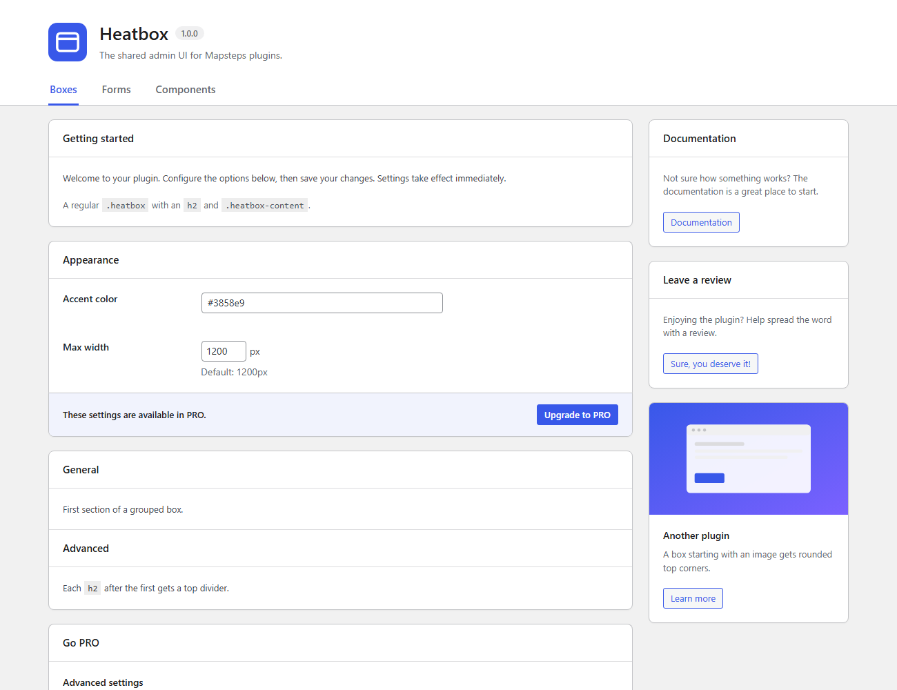
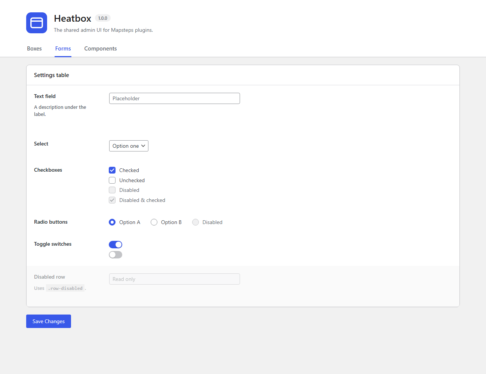
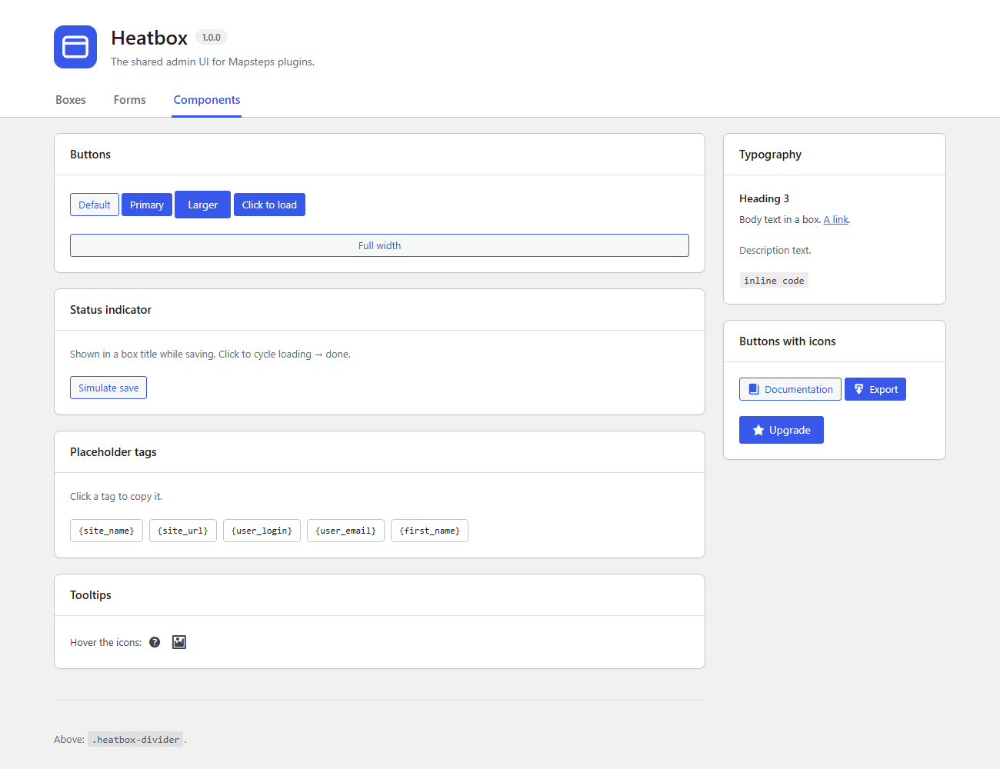

# Heatbox

A lightweight admin UI for WordPress plugin settings pages, used across all [Mapsteps](https://mapsteps.com) plugins. It's a single CSS file with no build step and no dependencies, and it follows the user's admin color scheme.



| Forms | Components |
|---|---|
|  |  |

## Showcase plugin

This repo is also a WordPress plugin. Activate **Heatbox** and open **Tools → Heatbox** to see every component with sample data. The markup in [`showcase/template.php`](showcase/template.php) is the reference for how to use each component. `showcase/` is demo only and is not copied into plugins.

## Usage

Copy `heatbox.css` into your plugin (e.g. `assets/css/`) and enqueue it on your settings page:

```php
wp_enqueue_style( 'heatbox', PLUGIN_URL . 'assets/css/heatbox.css', array(), PLUGIN_VERSION );
```

Add `heatbox-admin has-header` to the admin body class on that page. This removes the WP side padding so the header spans the full width:

```php
add_filter( 'admin_body_class', function ( $classes ) {
	return 'settings_page_my-plugin' === get_current_screen()->id ? $classes . ' heatbox-admin has-header' : $classes;
} );
```

## Theming

All colors, borders, radii and spacing are `--heatbox-*` custom properties (section 1 of `heatbox.css`). The accent color comes from the user's admin color scheme. Override any token per plugin:

```css
.my-plugin .heatbox-wrap {
	--heatbox-accent: #e63946;
	--heatbox-box-padding: 24px;
}
```

Status colors are `--heatbox-success`, `--heatbox-error` and `--heatbox-warning`, each with a `-soft` background shade.

Boxes use `--heatbox-radius`, `--heatbox-box-border`, `--heatbox-box-padding` and `--heatbox-shadow`. Text fields & selects inside a box use `--heatbox-control-height`, `--heatbox-radius-control` and `--heatbox-border`, with a focus ring in the accent color.

## Components

| Class | What |
|---|---|
| `.heatbox-wrap` | Page wrapper |
| `hr.wp-header-end` | WordPress' marker: admin notices are moved right after it. Put it at the top of `.heatbox-main` |
| `.heatbox-header` (`.heatbox-has-tab-nav`), `.logo-container`, `h1.title`, `.subtitle`, `.version` | Page header. Use an `h1` for the title: the page needs one |
| `.heatbox-tab-nav` (`li.active`) | Tabs in the header. Give each tab and its `.heatbox-admin-panel` the same `data-panel="name"`; your JS shows the matching panel (see `showcase/showcase.js`) |
| `.heatbox-admin-panel` | Tab panel, hidden until your JS shows it |
| `.heatbox-container` (`-wide`, `-center`) | Max-width container |
| `.heatbox-column-container` > `.heatbox-main` + `.heatbox-sidebar` | Two columns |
| `.heatbox-columns` > `.heatbox` × 2 | Two boxes side by side, stacked on small screens |
| `.heatbox` > `h2` + `.heatbox-content` | Box (`.is-grouped` for several sections) |
| `.heatbox.is-locked` | Faded, non-clickable box content (e.g. PRO-only settings) |
| `.heatbox-badge` (`.is-success`, `.is-warning`, `.is-error`, `.is-neutral`) | Pill badge, e.g. PRO next to a title, or a status like Active / Failed |
| `.heatbox-features` > `li` > `.dashicons` + `div` | Two-column feature list with check marks |
| `.heatbox .form-table`, `.setting-fields` > `.setting-field` | Settings (text fields, selects & textareas inside a box are styled too) |
| `.label.checkbox-label` / `.label.radio-label` + `.indicator` | Checkbox / radio |
| `.toggle-switch` > `input` + `.switch-track` > `.switch-thumb` | Toggle |
| `input.small-text` + `span.heatbox-unit` | Small number field with a unit, e.g. `px` |
| WP's `wp-color-picker` (with or without the alpha add-on) | Color field, styled like the inputs; nothing extra to add |
| `.button.is-loading`, `.button-larger`, `.button-full`, `.button.is-destructive`, `.button > .dashicons` | Button modifiers (`.is-destructive`: red outline, e.g. Reset) |
| `.heatbox-cta` (`.primary`, `.secondary`), `.heatbox-cta-container.is-attached` | Call to action |
| `.heatbox-form-footer` > `div` + `div` | Save on the left, reset on the right, below the boxes |
| `.heatbox-notice` (`.is-shown`, `.is-success`, `.is-error`, `role="status"`) | Save message next to the save button in the form footer |
| `.heatbox-status-indicator` (`.is-loading`, `.is-done`) | Save status inside a box title (for settings saved per box) |
| `.tags-heatbox`, `.tags-wrapper code` | Copyable tags |
| `ol.heatbox-steps` > `li` | Numbered steps |
| `.heatbox-copy` > `code` + `.button` (`.is-copied`) | Code snippet with a copy button |
| `.heatbox-tooltip` > `.tooltip-content` (`.has-image`) | Tooltip |
| `.heatbox-products` > `h2` + `ul.products` > `li.heatbox` + `.credit` | "Our other products" section below the settings (`.featured-products` still works) |
| Sidebar review box: `.heatbox` > `h2` "Leave a review" + `.heatbox-content` > `p.description` + `a.button` | No extra CSS. Add `<span class="screen-reader-text"> (opens in a new tab)</span>` to links with `target="_blank"` |
| `.heatbox-divider`, `.heatbox-margin-top/-bottom`, `.row-disabled` | Utilities |
| `[hidden]` | Hides an element even if heatbox or WP gives it a `display` (e.g. a `.button`) |

RTL is supported, mostly through logical properties. It works in all current browsers and uses `:has()` and `color-mix()`.

## License

GPL v2 or later.
