# Heatbox alternatives

Three proposed versions of `heatbox.css`, made while redesigning the WP Video Popup (free) settings page. They are proposals for review. The main `heatbox.css` is unchanged.

Each `heatbox-alt-N.css` is a full copy of `heatbox.css` with its changes applied. All existing classes keep working, so a plugin can load an alt file in place of `heatbox.css` without changing its markup. To see exactly what a version changes:

```sh
git diff --no-index heatbox.css alternatives/heatbox-alt-1.css
```

| File | Used by | Header & tabs | Boxes & CTAs | New components |
|---|---|---|---|---|
| `heatbox.css` | baseline | — | — | — |
| `heatbox-alt-1.css` | Layout A (clean & guided) | Compact | Refined | brand, header actions, badge, field, code, steps, features, product list, credit |
| `heatbox-alt-2.css` | Layout B (tabbed) | **Unchanged** | Refined | badge, field, code, features, product list, split, tip, locked, tiles, section title |
| `heatbox-alt-3.css` | Layout C (hero + preview) | Compact | Refined | badge, field, code, hero, hero panel, browser mockup, comparison table, footer links |

## Screenshots

Every heatbox element rendered with each version (same markup, only the CSS differs). Components a version adds are labelled NEW at the bottom of its page.

| heatbox.css | heatbox-alt-1 | heatbox-alt-2 | heatbox-alt-3 |
|---|---|---|---|
| [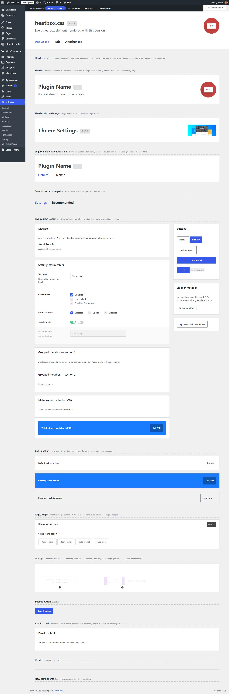](screenshots/heatbox/00-heatbox-1440.jpg) | [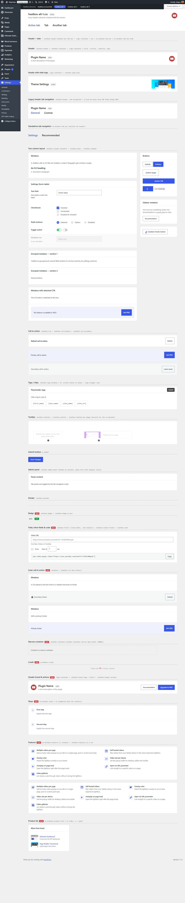](screenshots/heatbox/01-heatbox-alt-1-1440.jpg) | [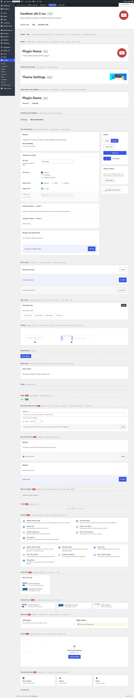](screenshots/heatbox/02-heatbox-alt-2-1440.jpg) | [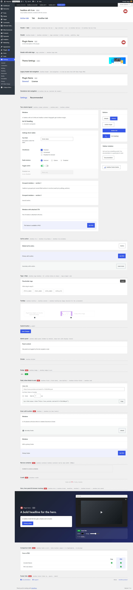](screenshots/heatbox/03-heatbox-alt-3-1440.jpg) |

The WP Video Popup settings page built on each version, at 1440px and 400px:

| | Desktop | Phone |
|---|---|---|
| Current | [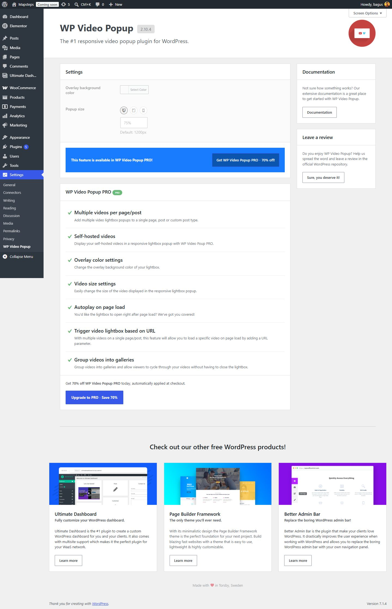](screenshots/wp-video-popup/01-current-1440.jpg) | [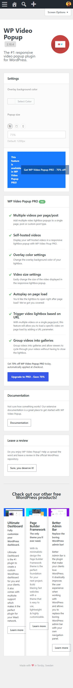](screenshots/wp-video-popup/01-current-400.jpg) |
| A · Clean & guided (alt-1) | [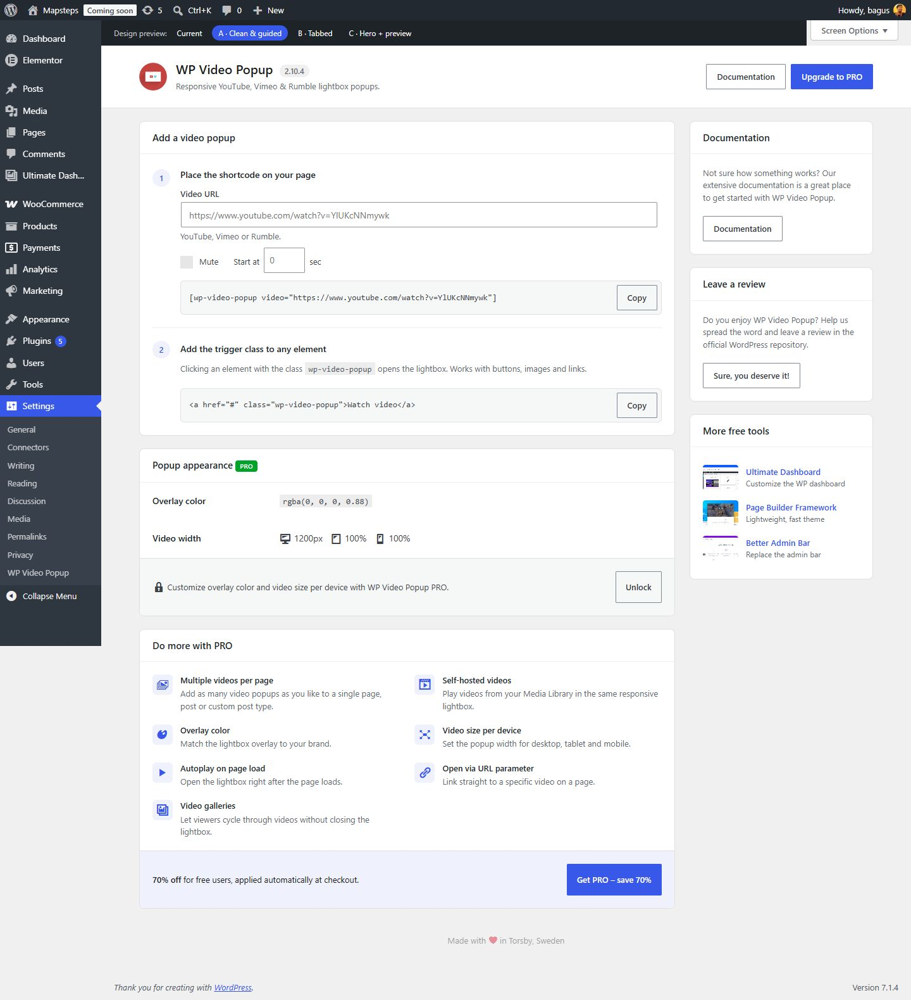](screenshots/wp-video-popup/02-a-clean-guided-1440.jpg) | [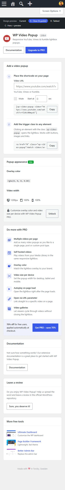](screenshots/wp-video-popup/02-a-clean-guided-400.jpg) |
| B · Tabbed (alt-2) | [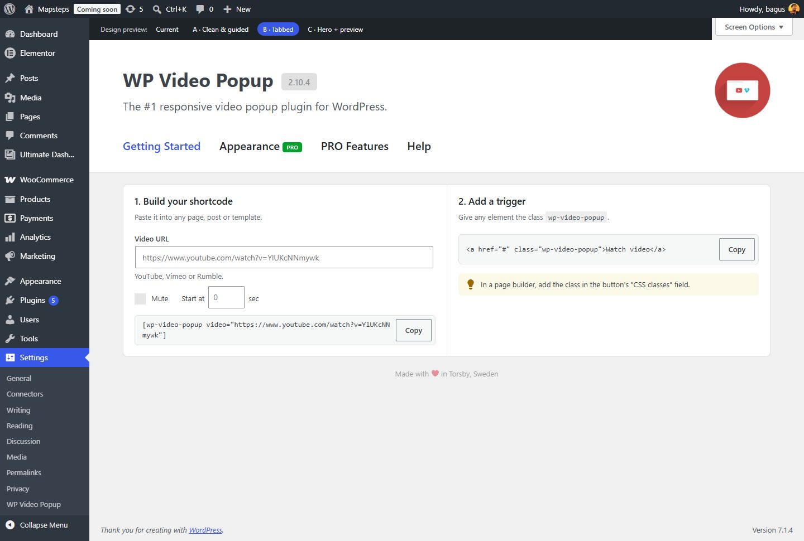](screenshots/wp-video-popup/03-b-tabbed-getting-started-1440.jpg) | [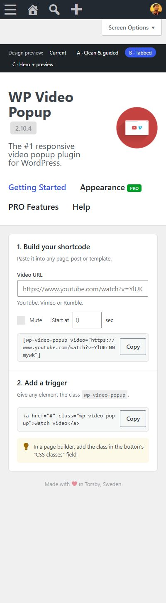](screenshots/wp-video-popup/03-b-tabbed-getting-started-400.jpg) |
| B · Appearance tab | [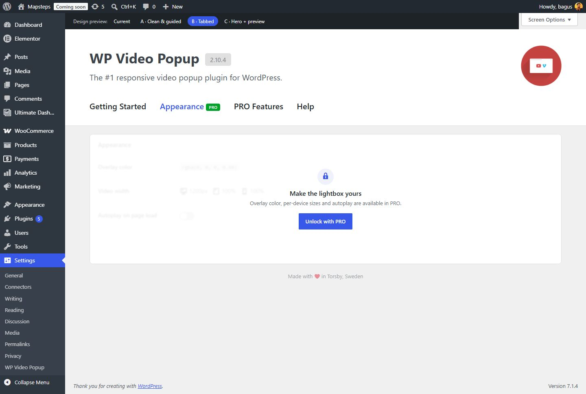](screenshots/wp-video-popup/04-b-tabbed-appearance-1440.jpg) | |
| B · PRO Features tab | [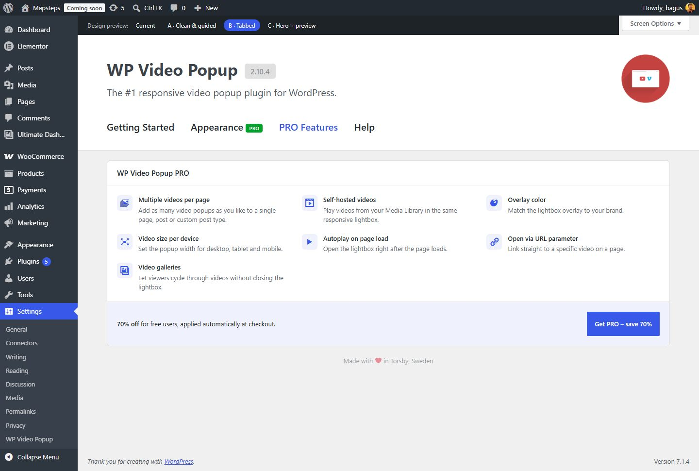](screenshots/wp-video-popup/05-b-tabbed-pro-features-1440.jpg) | |
| B · Help tab | [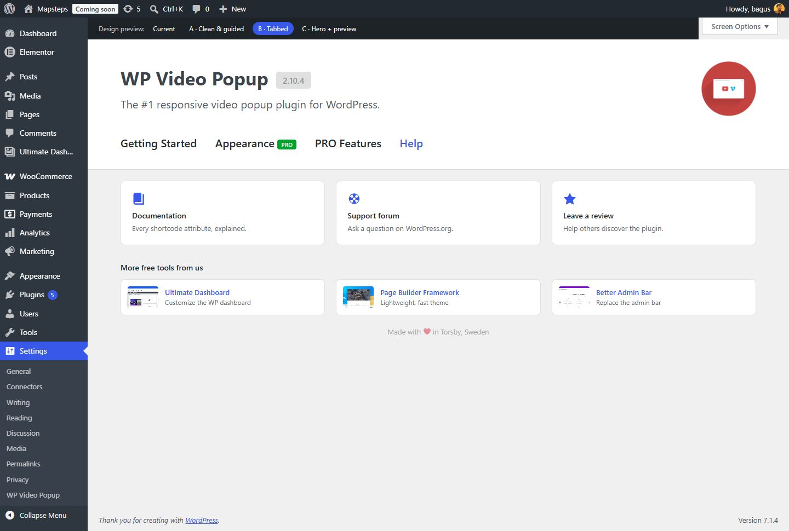](screenshots/wp-video-popup/06-b-tabbed-help-1440.jpg) | |
| C · Hero + preview (alt-3) | [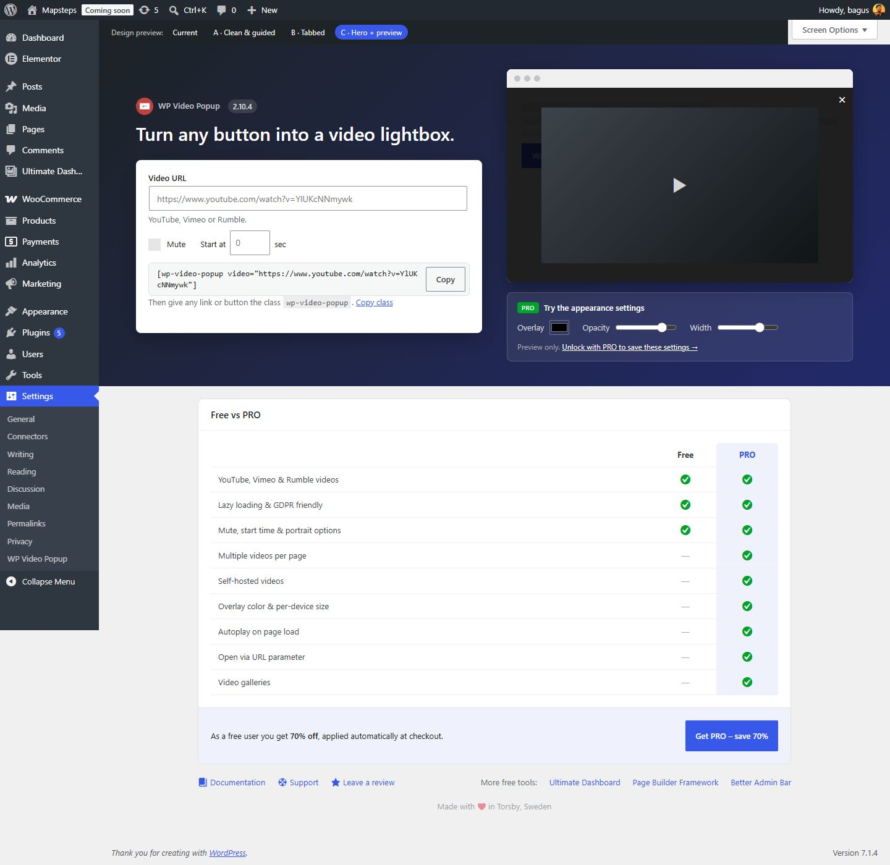](screenshots/wp-video-popup/07-c-hero-preview-1440.jpg) | [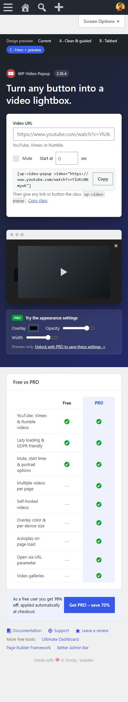](screenshots/wp-video-popup/07-c-hero-preview-400.jpg) |

Admin notices are hidden in the screenshots. Tooltips are forced open on the element pages.

## Changes to existing rules

These affect every plugin that switches to an alt file.

**Header** (alt-1, alt-3)
- `.heatbox-header`: 24px top padding instead of 40px.
- `.logo-container`: wraps, spaces its children apart with `justify-content: space-between`, 24px bottom margin. `.logo-container div { width: 50% }` becomes `.logo-container > div { width: auto }`, so nested divs are no longer forced to half width.
- `.logo-container img`: 44px wide, no float.
- `.title`: 20px / 600 instead of 34px / 700. `.subtitle`: 13px, muted.
- `.version`: a small grey pill.

**Boxes & CTAs** (all three)
- `.heatbox`: 8px radius, `#e0e0e0` border. `.heatbox h2`: 15px, `16px 20px` padding, lighter divider.
- `.heatbox-cta-container.is-attached`: rounded bottom corners. The box above it loses its bottom radius via `.heatbox:has(+ .heatbox-cta-container.is-attached)`.
- `.heatbox-cta`: 6px radius.
- `.heatbox-cta.primary`: **a soft tint of the admin accent with dark text, instead of the bright blue banner.** Its `.button` keeps the normal WordPress styling. Any plugin using `.heatbox-cta.primary` will look different.
- `.heatbox-cta.secondary`: `#f6f7f7` background, normal font weight.

alt-2 leaves the header, `.heatbox-tab-nav` and `.tab-navigation` exactly as in `heatbox.css`, so it matches Ultimate Dashboard and Page Builder Framework Premium.

## New components

All are prefixed `heatbox-`, use short unprefixed child classes and `is-*` modifiers, like the existing components.

### Shared (all alt files)

```html
<!-- Badge -->
<span class="heatbox-badge">Beta</span>
<span class="heatbox-badge is-pro">PRO</span>

<!-- Field with inline options and a copyable code line -->
<div class="heatbox-field">
	<label for="url" class="field-label">Video URL</label>
	<input type="url" id="url" class="large-text">
	<p class="description">YouTube, Vimeo or Rumble.</p>

	<div class="heatbox-inline-fields">
		<label class="label checkbox-label">Mute<input type="checkbox"><div class="indicator"></div></label>
		<label>Start at <input type="number" class="small-text"> sec</label>
	</div>

	<div class="heatbox-code">
		<code>[wp-video-popup video="…"]</code>
		<button type="button" class="button">Copy</button>
	</div>
</div>

<!-- A CTA as the last child of a box becomes its footer -->
<div class="heatbox">
	<h2>Title</h2>
	<div class="heatbox-content">…</div>
	<div class="heatbox-cta secondary"><p>Text</p><a class="button" href="#">Action</a></div>
</div>

<!-- Narrow container (max-width 1000px) -->
<div class="heatbox-container heatbox-container-center heatbox-container-narrow">…</div>

<p class="heatbox-credit">Made with ❤ in Torsby, Sweden</p>
```

### alt-1

```html
<!-- Header: logo next to the title, buttons on the right -->
<div class="logo-container">
	<div class="heatbox-brand">
		
		<div>
			<span class="title">Plugin Name <span class="version">1.0.0</span></span>
			<p class="subtitle">Description</p>
		</div>
	</div>
	<div class="heatbox-header-actions">
		<a class="button" href="#">Documentation</a>
		<a class="button button-primary" href="#">Upgrade</a>
	</div>
</div>

<!-- Numbered steps (CSS counters, no number markup needed) -->
<ol class="heatbox-steps">
	<li><h3>First step</h3>…</li>
	<li><h3>Second step</h3>…</li>
</ol>
```

### alt-1 and alt-2

```html
<!-- Feature grid: 2 columns, or 3 with .is-3-col -->
<ul class="heatbox-features is-3-col">
	<li>
		<span class="dashicons dashicons-format-video"></span>
		<div><h3>Feature</h3><p>Description.</p></div>
	</li>
</ul>

<!-- Product list (sidebar); add .is-row and li.heatbox for a 3-column row (alt-2) -->
<ul class="heatbox-product-list">
	<li><div><a href="#">Product</a><span>Tagline</span></div></li>
</ul>
```

### alt-2

```html
<!-- Two columns inside one box -->
<div class="heatbox">
	<div class="heatbox-split">
		<div class="heatbox-content">…</div>
		<div class="heatbox-content">…</div>
	</div>
</div>

<div class="heatbox-tip"><span class="dashicons dashicons-lightbulb"></span><p>A hint.</p></div>

<!-- Locked settings: blurred content behind an unlock overlay -->
<div class="heatbox heatbox-locked">
	<div class="locked-content" inert>…settings…</div>
	<div class="locked-overlay">
		<span class="dashicons dashicons-lock"></span>
		<h2>Unlock these settings</h2>
		<p>Available in PRO.</p>
		<a class="button button-primary" href="#">Unlock with PRO</a>
	</div>
</div>

<!-- Link tiles -->
<div class="heatbox-tiles">
	<a class="heatbox" href="#"><span class="dashicons dashicons-book"></span><h3>Documentation</h3><p>…</p></a>
</div>

<h2 class="heatbox-section-title">Section title</h2>
```

### alt-3

```html
<!-- Dark hero: two columns -->
<div class="heatbox-hero">
	<div class="heatbox-container heatbox-container-center">
		<div>
			<div class="heatbox-brand"> Plugin Name <span class="version">1.0.0</span></div>
			<span class="headline">Headline.</span>
			<div class="heatbox"><div class="heatbox-content">…</div></div>
		</div>
		<div>
			<div class="heatbox-browser">
				<div class="browser-bar"><i></i><i></i><i></i></div>
				<div class="browser-page">
					<div class="browser-skeleton"><b></b><b></b><b></b></div>
					<div class="browser-overlay">
						<button type="button" class="browser-close">×</button>
						<div class="browser-media">…</div>
					</div>
				</div>
			</div>
			<div class="heatbox-hero-panel">
				<p class="panel-title">Title</p>
				<div class="panel-controls"><label>Color <input type="color"></label></div>
				<p class="panel-note">Note. <a href="#">Link</a></p>
			</div>
		</div>
	</div>
</div>

<!-- Comparison table -->
<div class="heatbox-content heatbox-table-scroll">
	<table class="heatbox-compare">
		<thead><tr><th></th><th>Free</th><th class="is-highlighted">PRO</th></tr></thead>
		<tbody>
			<tr>
				<th scope="row">Feature</th>
				<td><span class="is-missing">—</span></td>
				<td class="is-highlighted"><span class="dashicons dashicons-yes-alt"></span></td>
			</tr>
		</tbody>
	</table>
</div>

<div class="heatbox-footer-links">
	<a href="#"><span class="dashicons dashicons-book"></span> Docs</a>
	<span class="spacer"></span>
	<span class="label">More:</span> <a href="#">Product</a>
</div>
```

## Regenerating

The alt files are generated from `../heatbox.css` by `build.mjs`. After changing `heatbox.css`, run:

```sh
node alternatives/build.mjs
```

Every change in the script must match exactly once in `heatbox.css`. If a rule it changes was edited, the build stops and prints the rule it couldn't find. Don't hand-edit the alt files unless you stop using the script.

## Notes

- Ultimate Dashboard ships a newer `heatbox.css` with `.heatbox-status-indicator`. That component isn't in main, so it isn't in the alt files either.
- The alt files use `color-mix()` and `:has()`, which are supported in all current browsers.
- The screenshots were taken from temporary, uncommitted review pages in a local WP Video Popup (free) install, at 1440px and 400px wide.
